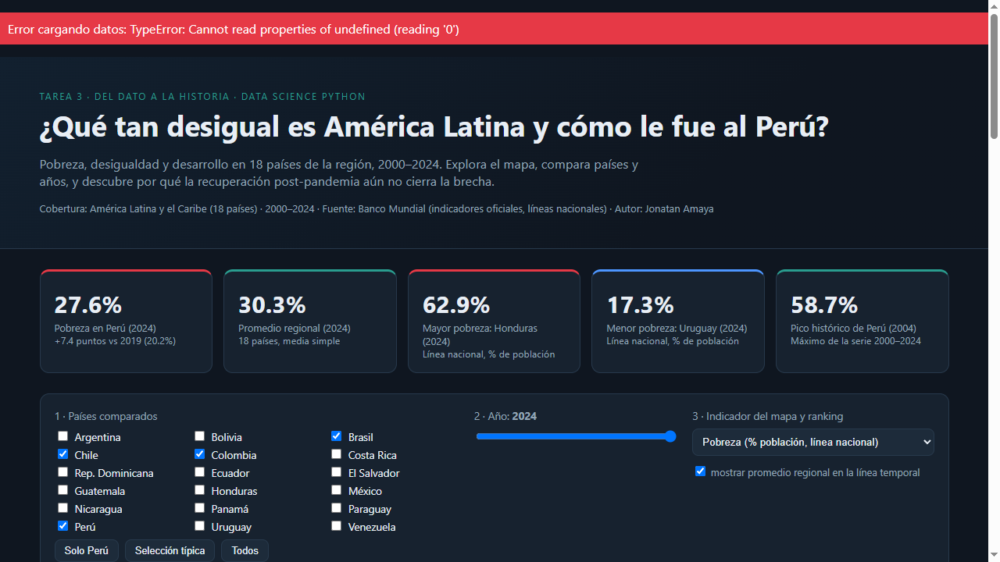
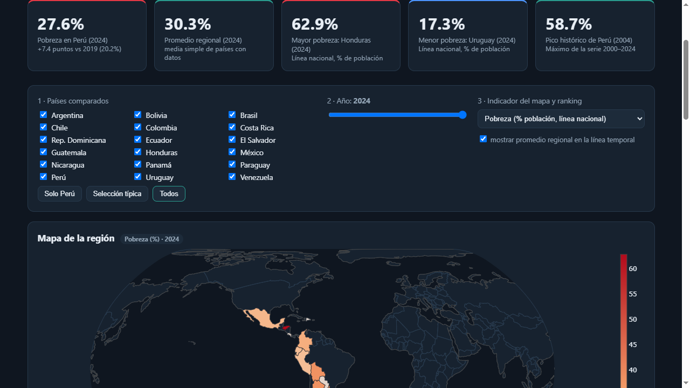
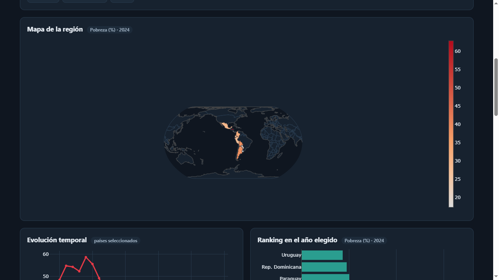

# 🌎 Tarea 3 – Del dato a la historia: pobreza y desigualdad en América Latina

## 1. Tema y pregunta de investigación

**Tema:** Pobreza, desigualdad y desarrollo en América Latina, con Perú como caso central.

**Pregunta de investigación:** *¿Qué tan desigual es América Latina y cómo le fue al Perú entre 2000 y 2024?*

**Cobertura:** 18 países de América Latina y el Caribe · 2000–2024.

## 2. Descripción breve del proyecto

El proyecto transforma series oficiales del Banco Mundial en dos productos complementarios:

1. **Un dashboard público e interactivo** (HTML + Plotly, desplegado en GitHub Pages) con
   5 KPIs, 4 visualizaciones (mapa coroplético, línea temporal, ranking y dispersión) y
   4 controles interactivos (selección de países, año, indicador y promedio regional),
   además de tabla con descarga CSV.
2. **Un reel de divulgación** (45–75 s, 9:16, 1080×1920) con narración generada por IA,
   gráficos de los propios datos, música sintetizada y subtítulos sincronizados.



## 3. Fuentes de datos y metodología

**Fuente:** [Banco Mundial – API pública de indicadores](https://data.worldbank.org)
(consultada el 2026-11-01). Indicadores: `SI.POV.NAHC` (pobreza, línea nacional),
`SI.POV.GINI` (índice de Gini) y `NY.GDP.PCAP.CD` (PBI per cápita US$). Para Perú, la
serie de pobreza coincide con las cifras oficiales del INEI (línea nacional).

**Pipeline (reproducible):**

| Paso | Script | Salida |
|---|---|---|
| Descarga | `scripts/obtener_datos.py` | `datos/originales/wb_*.json` |
| Limpieza y pivotes | `scripts/procesar_datos.py` | `datos/procesados/*.csv`, `web/data/datos.json` |
| KPIs y hallazgos | `scripts/analizar_datos.py` | `web/data/hallazgos.json` |
| Gráficos del reel | `scripts/reel/crear_graficos_reel.py` | `reel/recursos/escena*.png` |
| Reel (TTS + video) | `scripts/reel/generar_reel.py` | `reel/reel.mp4`, `subtitulos.srt`, `guion.json` |

Se eliminaron duplicados, los faltantes quedaron explícitos como nulos y los promedios
regionales son medias simples de países con dato en cada año.

## 4. Tres hallazgos principales

1. **La pandemia borró una década de avances en Perú.** La pobreza pasó de 20.2 %
   (2019) a 30.1 % (2020): +9.9 puntos en un año. En 2024 se ubica en 27.6 %, todavía
   +7.4 puntos sobre el nivel prepandemia.
2. **La región está profundamente dividida y los caminos difieren.** En 2024 Honduras
   registra 62.9 % de pobreza frente a 17.3 % de Uruguay. Entre 2000 y 2024, Ecuador
   redujo la pobreza en 36.4 puntos; Costa Rica apenas 0.3.
3. **La desigualdad persiste como reto estructural.** El Gini de Perú cayó de 49.1
   (2000) a 40.1 (2024) —puesto 12 de 14 países con datos—, aún por encima de
   referentes como Uruguay (39.0).



## 5. Limitaciones del análisis

- La pobreza con **línea nacional** no es estrictamente comparable entre países (cada
  país define su umbral); sí lo es la evolución interna y el contraste aproximado.
- **Brasil** no reporta pobreza con línea nacional al Banco Mundial (sí Gini y PBI), por
  lo que queda fuera de los rankings de pobreza (17 países con datos).
- El **Gini** tiene cobertura parcial en 2024 (14 países) y valores faltantes en algunas
  series por país.
- Los datos 2024 pueden ser revisados por el productor oficial; el panel se congeló el
  2026-11-01.

## 6. Enlaces

- **Dashboard público:** https://jonatan-amaya.github.io/Intermediate_Python/tarea_3/web/
- **Repositorio:** https://github.com/jonatan-amaya/Intermediate_Python/tree/main/tarea_3
- **Publicación de LinkedIn:** *[pendiente — el estudiante publica el reel y pega aquí el enlace]*
  (alternativa sin LinkedIn: el reel está en `reel/reel.mp4` y es visible en el
  repositorio público; este README incluye imágenes del dashboard y hallazgos).



## 7. Instrucciones para reproducir

```bash
conda activate tarea1           # Python 3.11 (o crea un env con requirements.txt)
pip install -r requirements.txt

# 1) datos -> 2) procesamiento -> 3) hallazgos
python scripts/obtener_datos.py && python scripts/procesar_datos.py && python scripts/analizar_datos.py

# 4) dashboard local
cd web && python -m http.server 8000     # http://localhost:8000

# 5) reel (gráficos + narración TTS + música + video)
python scripts/reel/crear_graficos_reel.py
python scripts/reel/generar_reel.py      # genera reel/reel.mp4, subtitulos.srt, guion.json
```

El dashboard de producción se sirve desde GitHub Pages (rama `main`, carpeta raíz →
URL `/tarea_3/web/`).

## 8. Declaración del uso de inteligencia artificial

Se utilizó IA asistente (agente de código) en **todas las etapas**: diseño del tema,
descarga y limpieza de datos, construcción del dashboard, generación de los gráficos del
reel, redacción del guion, **clonación de la voz del estudiante** (se grabó una muestra
de 16 s de voz propia en `reel/recursos/mi_voz.wav` y con F5-TTS + whisper se generaron
las narraciones; VoxCPM2 se evaluó y descartó por no soportar español), **música
sintetizada por código** (sin derechos de autor) y ensamblado del video con moviepy.
Las cifras fueron verificadas contra la fuente oficial y la responsabilidad del
contenido es del estudiante.

---

**Estudiante:** Jonatan Amaya (@jonatan-amaya) · Curso Data Science Python · 2026-11-01
